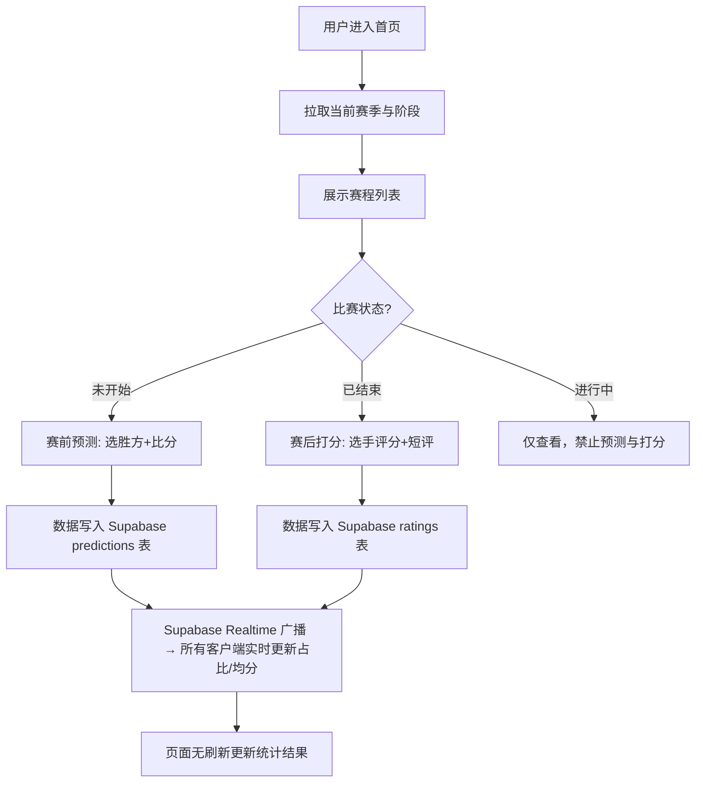

# KPL 虎扑式打分应用 — 产品需求文档 (PRD)

## 1. 产品概述

一款面向 KPL（王者荣耀职业联赛）观众的社区打分应用，参考虎扑的"赛后评分"模式，支持**赛前胜负预测**与**赛后选手打分评价**，所有用户交互数据通过 Supabase 实时同步。

- **目标用户**：关注 KPL 赛事、热衷于赛前预测与赛后选手评分讨论的电竞爱好者
- **核心价值**：让观众在赛前表达预判、赛后给选手打出 1-10 分并留下短评，数据实时上墙，形成社区氛围
- **部署约束**：前端静态资源部署于 GitHub Pages（免费），KPL 官方接口通过免费的边缘代理转发，业务数据存于 Supabase 免费版

## 2. 核心功能

### 2.1 用户角色

| 角色 | 注册方式 | 核心权限 |
|------|----------|----------|
| 游客 | 无需注册 | 浏览赛程、查看预测/打分统计结果 |
| 注册用户 | Supabase Email 登录（或匿名） | 提交赛前预测、赛后为选手打分与评论、编辑/删除自己的评价 |

### 2.2 功能模块

1. **首页（赛程列表）**：当前赛季阶段切换、即将开始的比赛（赛前态）、已结束比赛（赛后态）、比赛卡片展示双方队伍/时间/状态
2. **比赛详情页**：
   - 赛前态：胜负预测投票（胜方 + 比分预测）、实时预测比例条形图
   - 赛后态：双方首发选手列表、每位选手 1-10 分打分滑块 + 短评、实时平均分展示、评分人数、评论墙
3. **排行榜**：选手评分榜（按赛季/阶段聚合平均分）、预测命中率榜（用户维度）
4. **用户中心**：我的预测记录、我的打分记录、登录/登出

### 2.3 页面详情

| 页面名称 | 模块名称 | 功能描述 |
|----------|----------|----------|
| 首页 | 赛季/阶段选择器 | 调用 KPL 接口获取当前赛季与全部阶段，切换阶段刷新赛程 |
| 首页 | 比赛卡片列表 | 卡片显示双方队名/队徽、比赛时间、状态标签（未开始/进行中/已结束）、点击进入详情 |
| 首页 | 状态筛选 Tab | 全部 / 赛前 / 赛中 / 赛后 筛选 |
| 比赛详情 | 赛前预测面板 | 选择胜方 + 比分（BO7），提交后展示双方预测占比实时条形图（Supabase Realtime） |
| 比赛详情 | 选手打分面板 | 遍历双方首发选手，1-10 滑块 + 短评输入，提交后显示该选手实时平均分、评分人数 |
| 比赛详情 | 评论墙 | 展示所有用户对该场比赛的打分与短评，按时间倒序，支持点赞 |
| 排行榜 | 选手评分榜 | 按赛季聚合选手场均得分、评分次数，Top N 展示 |
| 排行榜 | 预测命中率榜 | 统计用户预测正确场次 / 总预测场次，Top N 展示 |
| 用户中心 | 登录/登出 | Supabase Auth 邮箱登录 |
| 用户中心 | 我的记录 | 我的预测列表、我的打分列表 |

## 3. 核心流程

## 4. 用户界面设计

### 4.1 设计风格

- **主色**：电竞红 `#E63946`（KPL 主色调）+ 金色点缀 `#FFB703`
- **背景**：深色电竞风 `#0B0E14` 主背景，卡片 `#151A23`，分隔线 `#232A36`
- **文字**：主文字 `#E8ECF1`，次要文字 `#8B95A7`
- **字体**：标题使用 `Oswald`（ condensed 竞技感），正文使用 `Noto Sans SC`
- **按钮**：圆角 6px，主按钮红色渐变带发光阴影，悬停有轻微放大与亮度提升
- **布局**：卡片式，顶栏固定导航，内容区居中最大宽度 1100px
- **动效**：页面加载卡片交错淡入、评分滑块拖动实时反馈、数据更新时数字滚动动画

### 4.2 页面设计概览

| 页面名称 | 模块名称 | UI 元素 |
|----------|----------|----------|
| 首页 | 赛季/阶段选择器 | 下拉选择框，深色背景，金色边框聚焦 |
| 首页 | 比赛卡片 | 双方队徽左右分布，中间 VS 标识，底部时间+状态标签 |
| 比赛详情 | 赛前预测 | 两队大按钮选择胜方，比分步进器，提交后占比进度条动画 |
| 比赛详情 | 选手打分 | 选手头像+名字行，右侧 1-10 滑块，下方短评输入，已提交显示均分 |
| 评论墙 | 评论项 | 用户头像、分数徽章（颜色随分数渐变）、短评文本、点赞数 |

### 4.3 响应式

桌面优先，最大内容宽度 1100px 居中；移动端（< 768px）卡片单列、滑块全宽、队徽缩小。触控区域不小于 44px。
