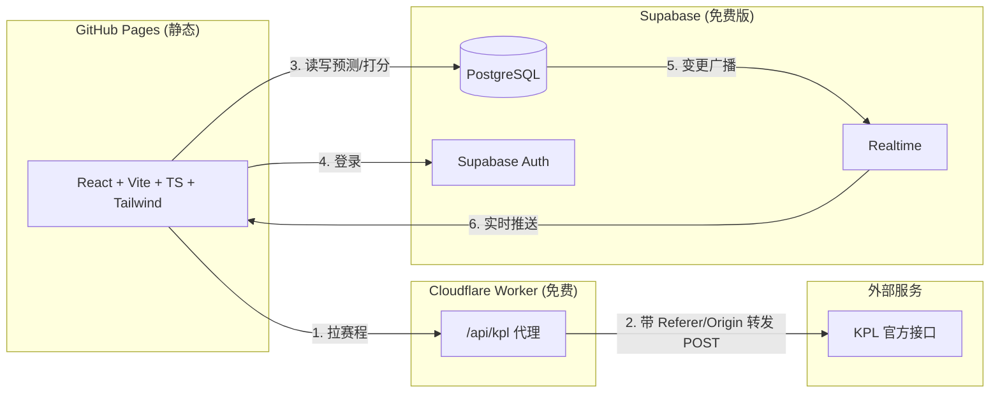
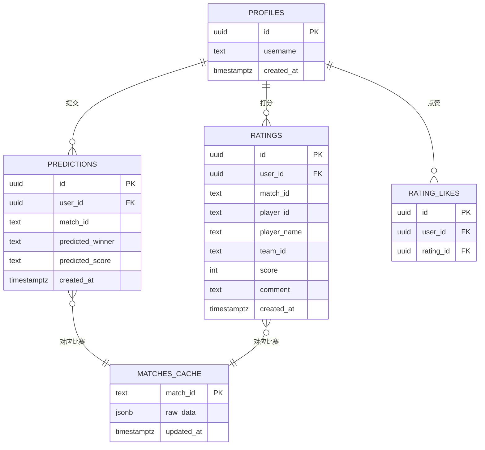

# KPL 虎扑式打分应用 — 技术架构文档

## 1. 架构设计



## 2. 技术说明

- **前端**：React@18 + TypeScript + Vite + TailwindCSS@3 + zustand（状态）+ react-router-dom（路由）+ @supabase/supabase-js
- **初始化工具**：vite-init（react-ts 模板）
- **KPL 接口代理**：Cloudflare Worker（免费 10 万请求/天），解决浏览器跨域 + 注入必需的 `Referer`/`Origin`/`User-Agent` 请求头
- **数据库**：Supabase PostgreSQL（免费版 500MB），开启 Realtime 实现预测占比/选手均分实时更新
- **认证**：Supabase Auth（邮箱密码，可匿名浏览）
- **部署**：前端 `npm run build` 产物通过 GitHub Pages 发布；Worker 单独部署到 Cloudflare

> 关于免费部署备选：若不想用 Cloudflare Worker，也可使用 **Vercel Serverless Functions**（免费 100GB 流量/月）或 **Netlify Functions**（免费 12.5 万次/月）作为 KPL 接口代理，前端仍部署 GitHub Pages 或对应平台。推荐 Cloudflare Worker，因其无冷启动、延迟最低。

## 3. 路由定义

| 路由 | 用途 |
|------|------|
| `/` | 首页：赛程列表 + 阶段切换 |
| `/match/:matchId` | 比赛详情：赛前预测 / 赛后打分 |
| `/ranking` | 排行榜：选手评分榜 + 预测命中率榜 |
| `/profile` | 用户中心：登录 + 我的预测/打分记录 |

## 4. 代理接口定义（Cloudflare Worker）

Worker 暴露三个端点，内部转发至 KPL 官方接口并注入必需请求头（解决跨域与防盗链）：

| 端点 | 方法 | 入参 | 说明 |
|------|------|------|------|
| `/api/season` | POST | `{}` | 获取赛季列表（转发 `getSeasonAndStageAndTeamList`） |
| `/api/schedule` | POST | `{ "seasonid": string, "stageid": string }` | 获取指定阶段赛程（转发 `getScheduleList`） |
| `/api/team` | POST | `{ "seasonid": string, "teamid": string }` | 获取战队大名单选手（转发 `getTeamsIntro`） |

**阶段自动发现**：Worker 内置一组 seed stageid（`cgs1,cgs2,cgs3,lts,twts,fts,zjs,bs,xs1,xs2`），对当前赛季逐个请求赛程，合并后提取去重的 `{stageid, stage_name}` 列表返回前端，支持后续新阶段自动识别。

请求头注入（Worker 端）：
```
Content-Type: application/json
Referer: http://kpl.qq.com/
Origin: http://kpl.qq.com
User-Agent: Mozilla/5.0 ... Edg/149.0.0.0
Accept: application/json, text/plain, */*
```

响应：直接透传 KPL 官方 JSON，并附加 CORS 头。

### 关键数据字段

**赛程（getScheduleList）单场比赛：**
| 字段 | 说明 |
|------|------|
| `scheduleid` | 比赛唯一 ID |
| `seasonid` / `stageid` / `stage_name` | 赛季 / 阶段 |
| `start_timestamp` | 开赛时间（Unix 秒） |
| `team_a_id` / `team_a_name` / `team_a_logo` / `team_a_score` | A 队信息 |
| `team_b_id` / `team_b_name` / `team_b_logo` / `team_b_score` | B 队信息 |
| `bo_total` | 赛制：1/3/5/7/9（BO1/BO3/BO5/BO7/BO9） |
| `competition_format` | 赛制描述，如 "BO7 第7局巅峰对决" |
| `schedule_status` | 状态：`1`=未开始，`4`=已结束（其他值视为进行中） |

**战队选手（getTeamsIntro → player_msg）：**
| 字段 | 说明 |
|------|------|
| `player_name_short` | 选手昵称（如"一诺"） |
| `player_name_real` | 真实姓名 |
| `position` | 位置：1=对抗路 2=中路 3=发育路 4=打野 5=游走 |
| `avatar` | 头像 URL |
| `Matchcount` / `KDA` / `DMGMin` | 赛季数据 |

### 实时更新策略

- **KPL 赛事数据**（赛程/比分/状态）：前端定时轮询 Worker。进行中的比赛每 30s 刷新一次，其他情况每 5min 刷新一次；用户进入详情页时立即拉取一次。
- **用户交互数据**（预测/打分/评论）：通过 **Supabase Realtime** 订阅 `predictions`、`ratings`、`rating_likes` 表的 INSERT/DELETE 事件，实现占比、均分、评论墙无刷新实时更新。

## 5. 数据模型

### 5.1 数据模型定义



### 5.2 数据定义语言 (DDL)

```sql
-- profiles 表（与 auth.users 关联）
create table public.profiles (
  id uuid primary key references auth.users(id) on delete cascade,
  username text,
  created_at timestamptz default now()
);

-- 赛前预测
create table public.predictions (
  id uuid primary key default gen_random_uuid(),
  user_id uuid not null references public.profiles(id) on delete cascade,
  match_id text not null,
  predicted_winner text not null,
  predicted_score text,
  created_at timestamptz default now(),
  unique (user_id, match_id)
);

-- 赛后选手打分
create table public.ratings (
  id uuid primary key default gen_random_uuid(),
  user_id uuid not null references public.profiles(id) on delete cascade,
  match_id text not null,
  player_id text not null,
  player_name text not null,
  team_id text not null,
  score int not null check (score >= 1 and score <= 10),
  comment text,
  created_at timestamptz default now(),
  unique (user_id, match_id, player_id)
);

-- 点赞
create table public.rating_likes (
  id uuid primary key default gen_random_uuid(),
  user_id uuid not null references public.profiles(id) on delete cascade,
  rating_id uuid not null references public.ratings(id) on delete cascade,
  unique (user_id, rating_id)
);

-- 比赛缓存（减少 KPL 接口调用，可选）
create table public.matches_cache (
  match_id text primary key,
  raw_data jsonb not null,
  updated_at timestamptz default now()
);

-- 开启 Realtime
alter publication supabase_realtime add table public.predictions;
alter publication supabase_realtime add table public.ratings;

-- RLS 策略
alter table public.profiles enable row level security;
alter table public.predictions enable row level security;
alter table public.ratings enable row level security;
alter table public.rating_likes enable row level security;

-- 所有用户可读
create policy "public read" on public.profiles for select using (true);
create policy "public read" on public.predictions for select using (true);
create policy "public read" on public.ratings for select using (true);
create policy "public read" on public.rating_likes for select using (true);

-- 仅本人可写自己的数据
create policy "user write own profile" on public.profiles for insert with check (auth.uid() = id);
create policy "user update own profile" on public.profiles for update using (auth.uid() = id);
create policy "user write own prediction" on public.predictions for insert with check (auth.uid() = user_id);
create policy "user delete own prediction" on public.predictions for delete using (auth.uid() = user_id);
create policy "user write own rating" on public.ratings for insert with check (auth.uid() = user_id);
create policy "user delete own rating" on public.ratings for delete using (auth.uid() = user_id);
create policy "user write own like" on public.rating_likes for insert with check (auth.uid() = user_id);
create policy "user delete own like" on public.rating_likes for delete using (auth.uid() = user_id);
```

## 6. 前端关键模块

- `src/lib/supabase.ts`：Supabase 客户端单例
- `src/lib/kpl.ts`：封装对 Cloudflare Worker 的赛程/赛季请求
- `src/store/`：zustand stores（用户态、赛程态）
- `src/pages/Home.tsx`：赛程首页
- `src/pages/MatchDetail.tsx`：比赛详情（赛前预测 + 赛后打分）
- `src/pages/Ranking.tsx`：排行榜
- `src/pages/Profile.tsx`：用户中心
- `src/components/`：MatchCard、PredictionPanel、RatingPanel、RatingSlider、CommentWall 等
- `worker/`：Cloudflare Worker 源码（独立部署）
